# HOME PROJECT — Vivienda Familiar Esquinera (2 Plantas)

Transformación arquitectónica y visualización fotorrealista de una vivienda esquinera de una planta en el **Caribe colombiano** hacia una residencia contemporánea de dos plantas (`90 m²` de lote provisional · `8,00 × 11,25 m`), desarrollada paramétricamente mediante **Blender 5.3.0 Beta**, **Python (`bpy` / `bmesh`)**, **Blender MCP 2.0** y **Cycles + NVIDIA OptiX (RTX 5070 Ti)**.

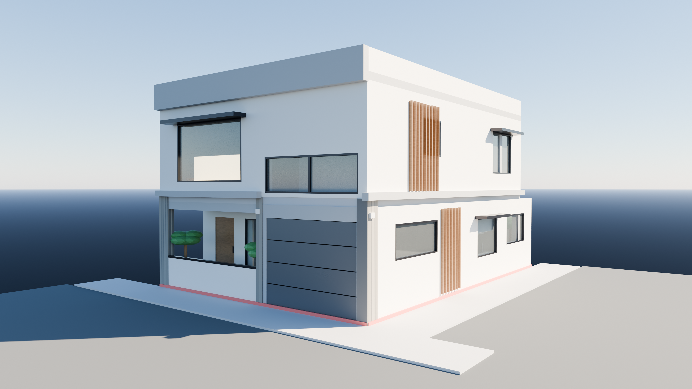

---

## Visión del Proyecto

| Parámetro | Especificación |
| :--- | :--- |
| **Lote provisional** | `8,00 × 11,25 m` (`90,00 m²`, esquinero con 2 fachadas) |
| **Primera planta** | `59,74 m²` útiles cubiertos (`75,85 m²` incluyendo terraza frontal y patio) |
| **Segunda planta** | `80,00 m²` brutos (`8,00 × 10,00 m`, `68,02 m²` útiles) |
| **Programa** | `4` habitaciones independientes · `3` baños completos · Garaje derecho (`Suzuki Swift Dzire 2023` + `Suzuki V-Strom 250 SX`) |
| **Altura libre** | `2,70 m` por planta (`2,90 m` entre pisos) |
| **Preparación energética y Unity** | `6` paneles solares + reserva de ampliación (`10,53 m²`), domótica conceptual y mallas UV/FBX-ready |

---

## Evolución por Hitos

### Progreso General (50 % completado)

- [x] **Hito 0** — Integración tecnológica (Blender 5.3 + MCP 2.0 + Cycles OptiX)
- [x] **Hito 1 / 1.1 / 1.2** — Distribución arquitectónica, contextualización de lote esquinero y consolidación con garaje frontal derecho
- [x] **Hito 2** — Volumetría completa, escalera funcional (`1,00 m` de desembarco), estructura conceptual y recorrido virtual (`48 s`)
- [x] **Hito 3** — Fachadas contemporáneas, celosías tropicales, piedra natural, iluminación nocturna y cubierta fotovoltaica
- [x] **Hito 4** — Interiorismo completo, vehículos a escala real, preinstalación energética y domótica conceptual
- [x] **Hito 5** — Renderizado fotorrealista (`AgX` + `Cycles OptiX` en `4K` y `2560 × 1440`)
- [ ] **Hito 6** — Auditoría integral
- [ ] **Hito 7** — Recorrido cinematográfico
- [ ] **Hito 8** — Simulador interactivo Unity
- [ ] **Hito 9** — Realidad virtual opcional

---

## Plantas Arquitectónicas y Volumetría

| Primera Planta (V3 Consolidada) | Segunda Planta (`8 × 10 m`) |
| :---: | :---: |
| 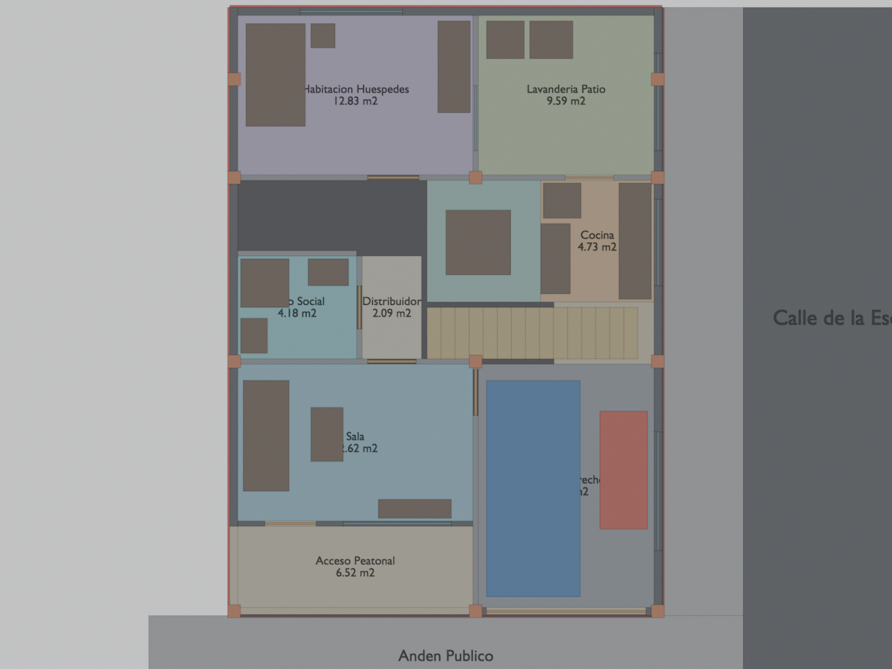 | 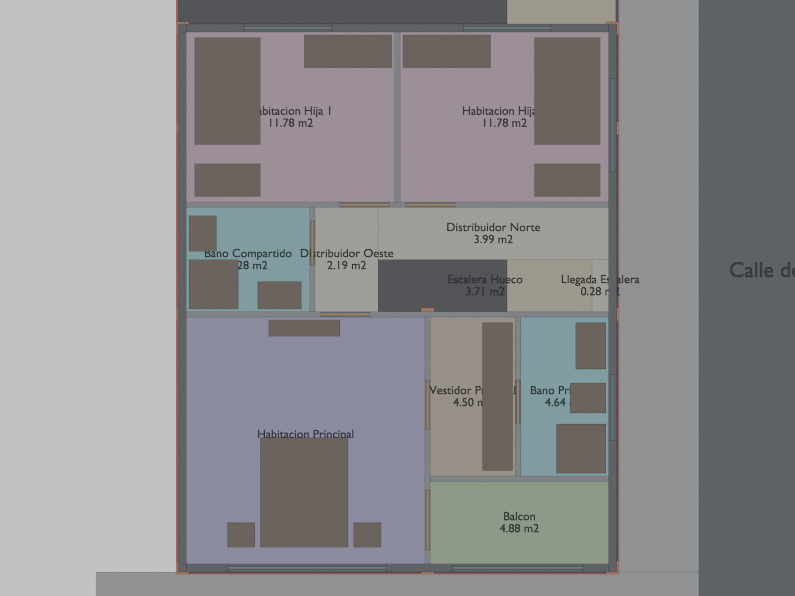 |

| Corte Longitudinal por Escalera | Isometría Amoblada P1 / P2 |
| :---: | :---: |
| 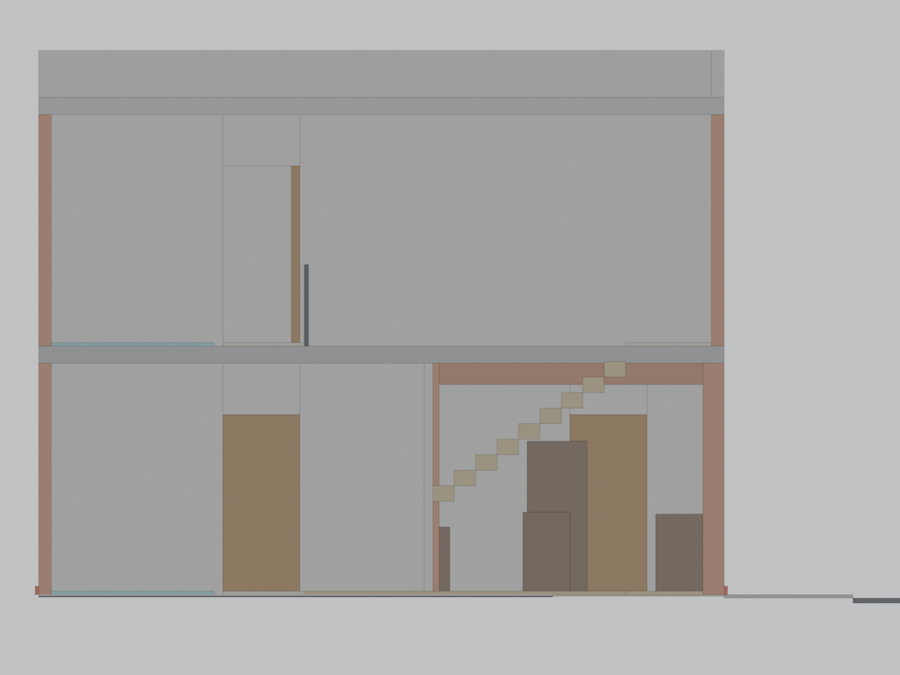 | 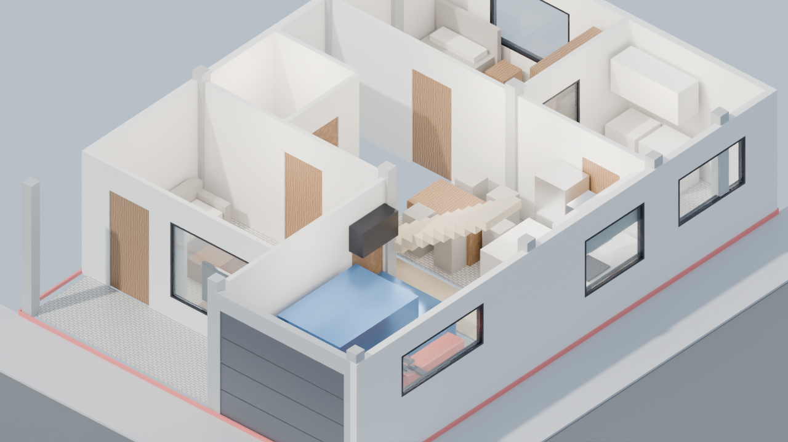 |

---

## Galería Fotorrealista (Hito 5 — Cycles OptiX + AgX)

### Exteriores (Día, Atardecer, Noche y Cubierta Solar)

| Atardecer Esquinero (4K) | Fachada Nocturna |
| :---: | :---: |
| 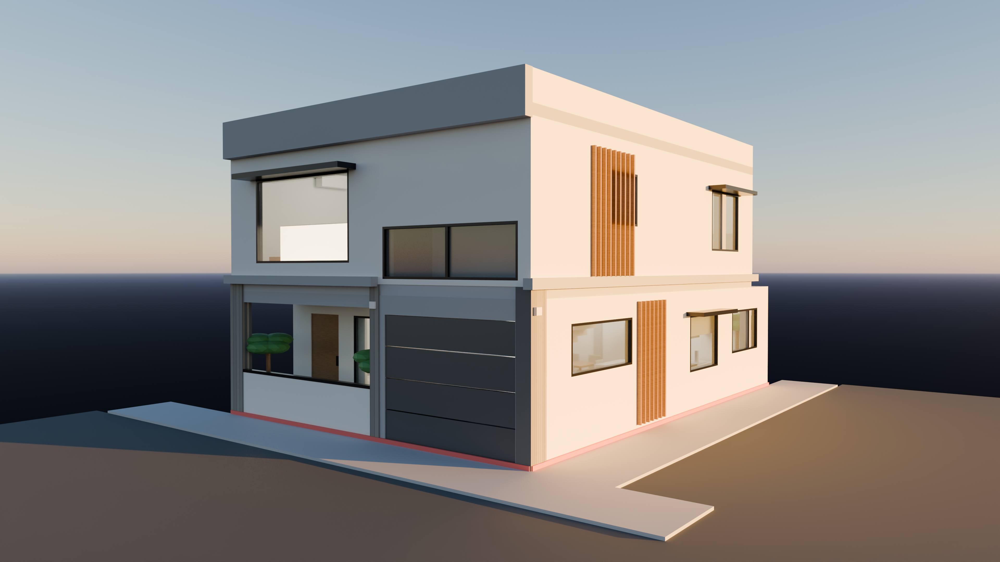 | 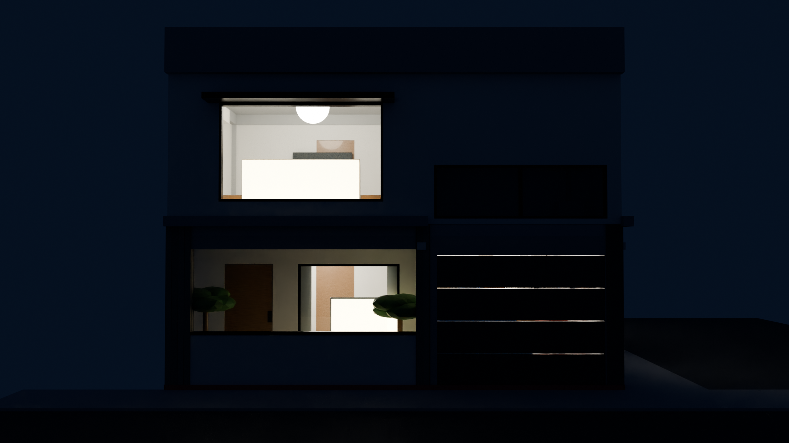 |

| Vista Aérea Fotovoltaica | Presentación Isométrica |
| :---: | :---: |
| 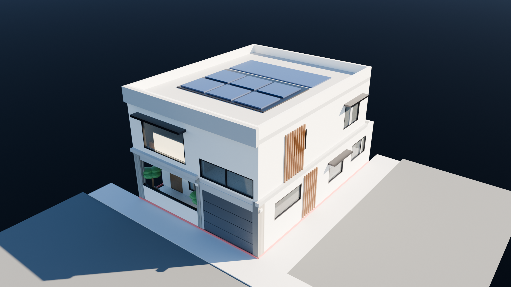 | 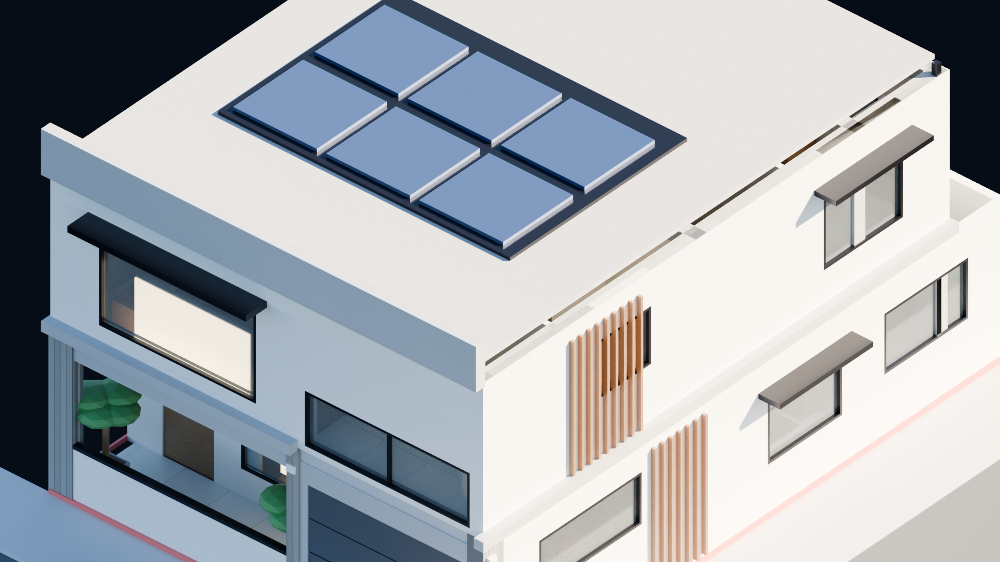 |

### Interiores

| Sala Contemporánea | Cocina Integral y Comedor | Suite Principal |
| :---: | :---: | :---: |
| 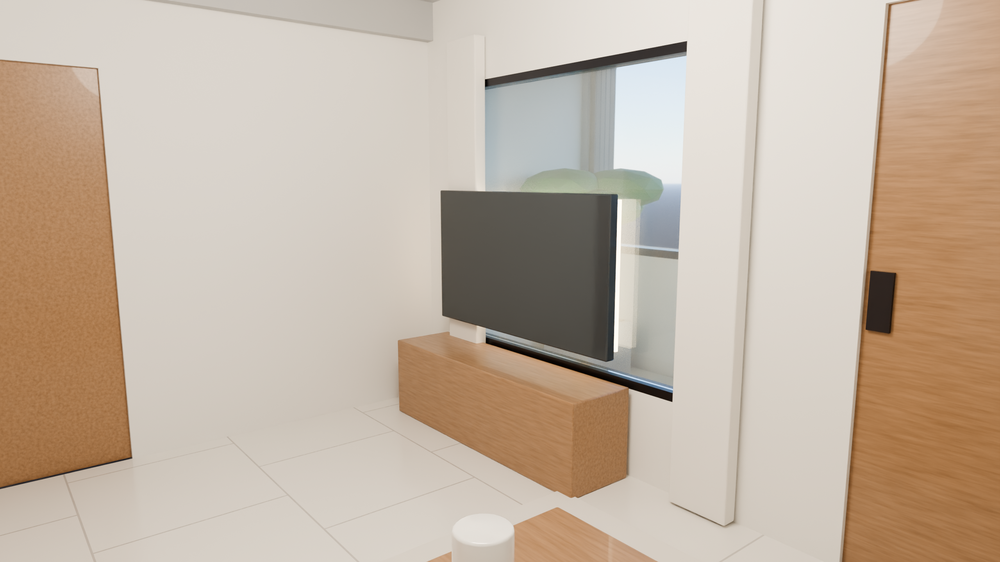 | 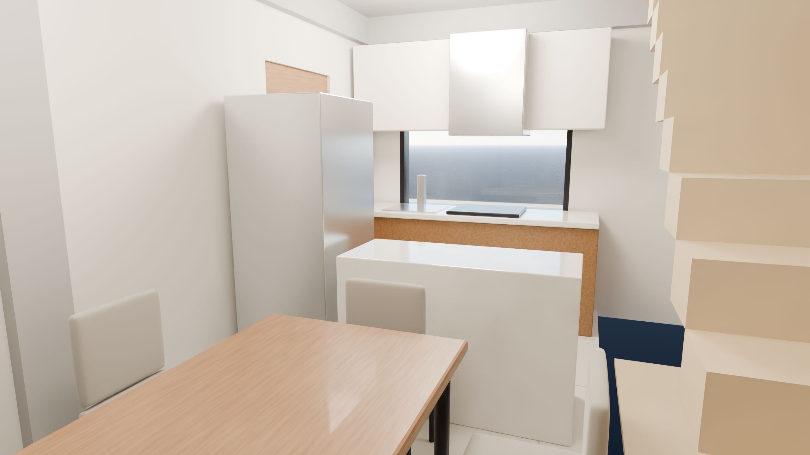 | 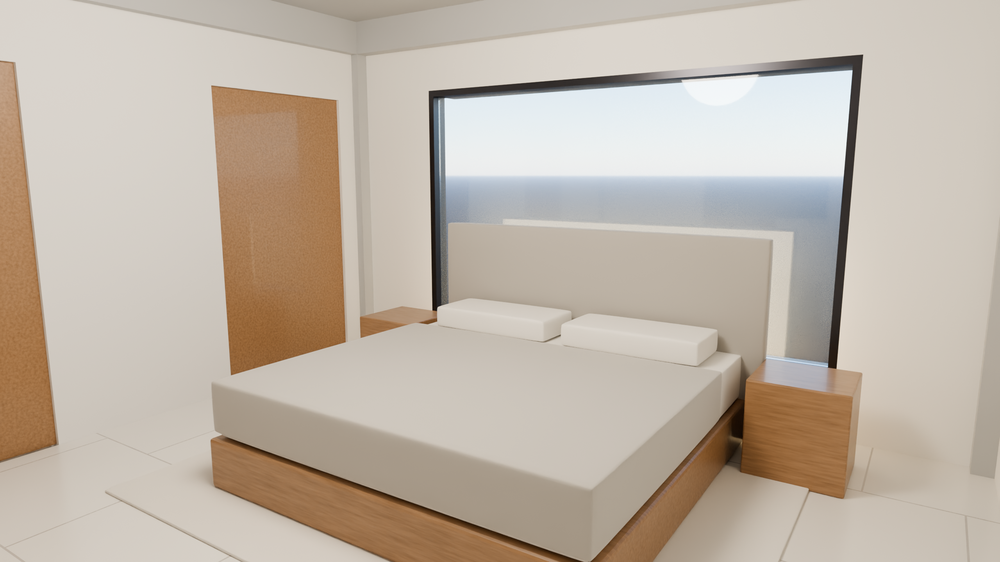 |

---

## Estructura del Repositorio

```text
home-project/
├── docs/           # Informes por hito, cuadros de áreas, catálogos PBR, estrategia Unity y benchmark
├── models/         # Modelos incrementales (.blend) desde Hito 1 hasta Hito 5
├── renders/        # Planos ortográficos, isométricas, video recorrido (Hito 2) y renders 4K/1440p (Hito 5)
├── scripts/        # Scripts Python/bpy reproducibles de modelado, renderizado y validación
└── validation/     # Reportes JSON de validación geométrica automatizada por hito
```

---

## Reproducibilidad y Validación

Cada hito cuenta con scripts independientes (`scripts/build_hito_*.py` y `scripts/validate_hito_*.py`) ejecutables dentro de Blender 5.3+ que verifican programáticamente:
- Límites superficiales y proyecciones de losas/cubiertas.
- Ausencia de colisiones de mobiliario y obstrucción de puertas.
- Holguras vehiculares (`Suzuki Swift Dzire 2023` + `Suzuki V-Strom 250 SX`).
- Altura libre sobre cada peldaño (`≥ 2,05 m`) y desembarco superior (`1,00 m`).
- Coordenadas UV y pivotes de puertas preparados para exportación FBX a Unity.

> **Nota técnica:** Las dimensiones del lote (`8,00 × 11,25 m`) son una hipótesis provisional y las validaciones estructurales, eléctricas (RETIE) y urbanísticas (POT) permanecen en estado `PENDING` hasta contar con revisión profesional certificada.
